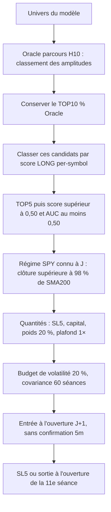

# Q051 — Volatilité 20 % + régime

Version documentée : 15 novembre 2026. Ce document décrit la référence
`q051_vol20_regime_v1`, son replay historique et son raccordement PAPER US.
Les variantes de recherche sont séparées du réglage actif.

## 1. Ce que la stratégie cherche à faire

Q051 sélectionne d'abord les actions dont l'Oracle prévoit une forte amplitude,
puis celles que les modèles LONG per-symbol jugent les plus favorables à un
achat protégé. Elle limite ensuite la quantité achetée selon le capital, le
risque au stop et les mouvements communs des positions. Elle autorise les
nouveaux achats uniquement dans un environnement SPY suffisamment favorable.

La référence est **LONG uniquement**. Elle ne vend pas à découvert les titres
écartés, même lorsque le batch contient aussi une branche SHORT.



Les refus ne sont pas remplacés par un titre moins bien classé. Le nombre
d'achats effectifs peut donc être inférieur à cinq, ou nul.

## 2. Les trois scores à ne pas confondre

### Nombre de variables d'entrée vérifié

Les six modèles annuels du témoin utilisent les mêmes nombres de variables :

| Composant | Nombre | Source du contrôle |
| --- | ---: | --- |
| Oracle parcours H10 | 173 | `oracle_path/feature_profile.json`, liste `feature_columns` |
| Chaque modèle per-symbol LONG | 24 | `oracle_path/directional/manifest.json`, liste `features` |
| Chaque modèle per-symbol SHORT | 24 | Même manifeste, branche SHORT archivée |

Les 24 variables per-symbol sont 21 indicateurs et trois variations sur cinq
séances. Oracle emploie notamment les prix/volumes, tendances, volatilités,
forces relatives, variables factorielles, interactions et rangs dans
l'univers. Les transformations et rangs comptent chacun comme une variable ;
173 ne désigne pas 173 fournisseurs ou sources indépendantes. Le nombre
de variables ne mesure pas à lui seul la qualité prédictive.
Le batch PAPER actuellement configuré `model-factory-20261114122842-c59bed`
présente également 173 variables Oracle et 24 variables par branche per-symbol.

### Oracle parcours H10 : repérer l'amplitude

L'Oracle travaille sur le parcours des **dix séances J+1 à J+10**, à partir
de la clôture J. Sur les données historiques, l'amplitude est le plus grand
des deux mouvements : hausse maximale et baisse maximale en valeur absolue.
Les prix sont comparés sur une même base d'ajustement et selon le calendrier
officiel ; les fenêtres non qualifiées ne servent pas de cible valide.

L'apprentissage distingue les titres appartenant au véritable TOP20 % des
amplitudes du jour. À la prédiction, Q051 conserve seulement le **TOP10 % du
classement Oracle** : ces deux pourcentages n'ont pas le même rôle.

L'Oracle ne fournit pas le sens LONG ou SHORT. Un score d'amplitude élevé
n'est ni un rendement attendu, ni une certitude de hausse, ni la promesse
d'un mouvement de 20 %.

Le nombre initial est dynamique : `arrondi supérieur(0,10 × taille de l'univers
du batch)`. Pour les modèles annuels du témoin, 1 790 titres donnent 179
candidats. Un batch avec un autre univers donne un autre nombre.

### Score LONG per-symbol : classer les candidats Oracle

Chaque action dispose de son modèle LONG. Dans le bundle de référence H10,
la cible est un **trade net positif**, avec entrée à l'ouverture J+1, SL5 %,
sortie open11 si le stop n'est pas touché, et frais de 0,08 % par côté dans
les labels. Il ne s'agit pas simplement de prévoir une clôture J+10 supérieure
à la clôture J, ni de prévoir le seul pic de hausse.

Les entrées du modèle comprennent des rendements/momentums sur plusieurs
périodes, RSI, ADX, ATR en pourcentage, pentes et distances aux moyennes,
position dans les ranges, volumes/volatilités, force relative et contexte
du benchmark. Trois variations sur cinq séances complètent ces variables.
Le calcul courant comporte 24 variables. Les news, consensus, options et
avis GPT ne participent pas à cette sélection Q051 de référence.

À l'intérieur des candidats Oracle, la stratégie trie le score LONG par ordre
décroissant et prend les cinq premiers. Elle applique ensuite les seuils :

- score LONG **strictement supérieur à 0,50** ; exactement 0,50 est refusé ;
- AUC LONG de calibration **supérieure ou égale à 0,50**, connue avant J et
  appartenant exactement aux poids utilisés pour ce titre.

Un score de 0,60 est une estimation issue du modèle. Il ne garantit pas un
taux gagnant réel de 60 %, particulièrement après sélection, contraintes de
capital et changement d'environnement.
Ce score est compris entre 0 et 1 ; il est distinct des anciens scores LLM
sur une échelle de 1 à 10.

### AUC : qualité historique de classement du modèle

L'AUC mesure la capacité du modèle à donner un score supérieur aux cas
gagnants par rapport aux cas perdants dans l'échantillon concerné. 0,50
correspond à une absence de discrimination sur cet échantillon ; une AUC
de 0,60 ne signifie pas 60 % de trades gagnants.

Q051 utilise l'AUC de **calibration antérieure**, pas une AUC calculée après
coup sur l'année testée. Elle vérifie la date de disponibilité et l'empreinte
du modèle. Une AUC absente, future ou provenant d'autres poids est rejetée.
Ce seuil ne constitue pas à lui seul une preuve de robustesse future.

### Exemple de sélection sans remplacement

Après Oracle, les cinq meilleurs scores LONG sont 0,66 ; 0,63 ; 0,58 ;
0,54 ; 0,51. Si le troisième titre a une AUC de 0,48, il est refusé : les
quatre autres continuent. Le sixième du classement n'est pas promu.
Si deux de ces quatre titres sont déjà détenus, il peut ne rester que deux
nouveaux achats possibles, avant les autres contraintes.

## 3. Le filtre de régime : SPY et moyenne 200 séances

À partir des clôtures disponibles jusqu'à la séance du signal J :

`achats autorisés si clôture SPY(J) > 0,98 × moyenne des 200 clôtures SPY jusqu'à J`.

Les 200 valeurs doivent être positives, finies et correctement datées. La
règle inclut la clôture J et ne consulte pas J+1 pour décider du régime.
À égalité avec le seuil, les nouveaux achats ne sont pas autorisés.

Exemple : avec une moyenne de 500 USD, SPY doit clôturer **au-dessus de
490 USD**. Ce n'est donc pas une obligation d'être au-dessus de la moyenne
elle-même : une marge de 2 % sous la moyenne est admise.

Si la règle refuse les achats, les titres existants ne sont pas liquidés
pour cette seule raison. Ils gardent leur stop et leur échéance open11.
La règle ne dépend pas ici du VIX, du consensus, d'un secteur ou d'un LLM.

## 4. Dimensionner une position : risque, poids et capital

### Paramètres de référence

| Paramètre | Valeur et signification |
| --- | --- |
| Risque budgété par entrée | 1,25 % du capital courant |
| SL | 5 % du prix d'achat, pas une distance ATR |
| Poids maximal par titre | 20 % du capital courant à l'admission |
| Plafond d'exposition brute des achats | 1× le capital courant |
| Positions simultanées | 20 au maximum |
| Montant minimal | 50 USD après dimensionnement |
| Quantités | Actions entières, pas de fractions |
| Position initiale | Complète par rapport à la quantité approuvée |
| Renforcement | Désactivé |
| Réserve de sizing | 25 points de base par opération |

Le risque de 1,25 % n'est **pas** le montant investi : il borne le risque
théorique associé au stop, avec réserve de coûts. Pour 4 000 USD, le budget
de risque est 50 USD, alors qu'une ligne peut représenter jusqu'à 800 USD.

Une première quantité entière est calculée en tenant compte du stop, de la
réserve de coûts et du poids maximal. Le replay emploie notamment :

`quantité brute = min(plancher(budget / [prix × (SL + 2,05 × réserve)]),
                      plancher(capital × poids maximal / prix))`.

La réserve considérée ne doit pas être inférieure aux frais simulés. Le
capital disponible, les positions et ordres déjà en cours, les plafonds et
le minimum de ligne peuvent réduire cette quantité ou refuser l'achat.

Exemple : capital 4 000 USD, prix 100 USD. Le poids maximal limite la ligne
à huit actions, soit 800 USD. Un stop théorique à 95 USD correspond à environ
40 USD de perte avant frais et éventuel gap. Le budget de volatilité peut
encore réduire ces huit actions. « Position complète » ne signifie ni tout
le compte dans une action, ni une garantie d'investir 100 % du capital.

### Pourquoi la capacité margin 2× ne donne pas 2× d'achats

Le compte simulé est margin et sa capacité théorique est 2×. Mais **le plafond
de risque Q051 reste 1×** pour les nouvelles entrées. Avec 4 000 USD, cela
limite l'exposition brute admise à environ 4 000 USD, sous réserve des autres
contraintes, même si le broker permet jusqu'à 8 000 USD.

Ce plafond d'admission n'est pas un rééquilibrage continu : des variations
de prix peuvent modifier l'exposition après l'achat. Q051 ne cherche pas à
consommer systématiquement toute la capacité disponible.

Dans les bilans, le capital engagé moyen est la moyenne de la valeur brute
des positions sur les points de valorisation intraday, périodes en cash
comprises. L'engagement moyen en pourcentage est la moyenne de chaque
rapport `exposition brute / equity courante`, et non le capital engagé moyen
divisé par les 4 000 USD initiaux. Les jours de régime défavorable, les
doublons déjà détenus, les seuils, les exclusions par titre et le budget de
volatilité peuvent laisser une part importante du compte en liquidités.

## 5. Volatilité 20 % : un budget commun aux positions

Le budget utilise les **60 derniers rendements journaliers complets connus
avant l'entrée** pour les positions détenues, les achats réservés et le
candidat. Il faut donc 61 clôtures pour produire ces 60 rendements. Les
dates manquantes sont exposées, pas comblées par des cours actuels.

Les covariances journalières sont estimées, puis annualisées avec 252 séances.
Avec les poids de portefeuille `w` et la matrice annualisée `Σ` :

`volatilité estimée = racine(wᵀ × Σ × w)`.

La stratégie compare le portefeuille existant et le portefeuille après
l'achat proposé :

1. Si le risque existant atteint déjà le budget de 20 %, l'achat est refusé.
2. Si la quantité proposée reste dans le budget, elle est conservée.
3. Sinon, la quantité est réduite jusqu'à respecter le budget, puis les
   contraintes natives de montant/capital sont appliquées à nouveau.

La quantité n'est jamais augmentée par ce budget. Les ordres en attente
comptent pour éviter de réserver plusieurs fois le même capital. Des titres
qui bougent ensemble consomment davantage de risque commun qu'une combinaison
moins corrélée. Le mécanisme tient donc compte des corrélations dans la
covariance, même si le filtre de corrélation séparé est désactivé.

**20 % est une estimation de volatilité annualisée, pas un rendement visé,
pas une garantie de risque réel et pas un plafond de DD.** Le budget agit
sur les nouveaux achats. Il ne liquide pas automatiquement les positions
parce que la volatilité réalisée augmente ensuite.

## 6. Contraintes conservées et contrôles désactivés

En plus des tailles et du budget de volatilité, la référence conserve :

- absence de doublon : pas de nouvel achat du même titre déjà détenu ou
  engagé dans une campagne active ;
- limite de dix entrées par titre sur 90 jours calendaires glissants ;
- exclusion temporaire de 90 jours après trois pertes consécutives sur
  ce titre, selon le suivi natif des trades ;
- vérification du capital, des réservations, des prix et des calendriers.

Ces valeurs proviennent du bloc `risk` figé de la référence. Certains anciens
champs de simulation de niveau supérieur affichent cinq pertes/30 jours :
ils sont conservés pour la traçabilité, mais ne remplacent pas les valeurs
effectivement utilisées par le risque Winner.

La référence désactive B4/DD15, la liquidation globale sur DD, le contrôle
factoriel, le filtre de corrélation séparé et les limites sectorielles.
Les seuils DD15/perte quotidienne encore présents dans le contrat archivé
ne deviennent pas actifs par leur seule présence. Elle n'ajoute pas non plus
de filtre options, GPT, consensus ou Global Ranking.

Cela ne désactive pas les contrôles d'intégrité d'un ordre PAPER : compte
actif, titre négociable, contrat compatible, watcher disponible, absence de
double soumission et réconciliation restent nécessaires.

## 7. Entrée et sorties

### Entrée directe J+1

J est la séance du signal, après sa clôture. L'achat vise l'ouverture de la
séance officielle suivante. Les week-ends et jours fériés ne sont pas comptés
comme séances. **Aucune confirmation de deux bougies 5 minutes** n'est exigée.
Une ouverture manquée n'est pas transformée automatiquement en achat plus tard.

Dans le replay, l'entrée se fait sur le prix d'ouverture journalier observé,
sous réserve du dimensionnement et du capital disponibles à cette ouverture.
En PAPER, les cibles sont préparées sur les informations disponibles avant
l'ouverture et soumises comme ordres d'ouverture. Le prix réellement exécuté
est celui retourné par le broker : il ne peut pas être connu à l'avance.
Cette différence interdit de promettre une identité de prix et de rendement
entre le replay et le compte PAPER.

Le raccordement PAPER applique aussi sa fenêtre de soumission des ordres
d'ouverture : après 19 h New York ou avant 9 h 28 pour l'ouverture visée,
avec vérification de J+1 et de l'heure limite. Une sélection correcte ne
suffit donc pas si la tentative arrive hors de la fenêtre admise.

### SL5 et échéance open11

Après le fill, Winner conserve les paramètres figés de la campagne :

| Protection | Référence |
| --- | --- |
| Stop initial | 5 % sous le prix d'achat effectif |
| TP | Aucun |
| Trailing | Aucun |
| Renforcement | Aucun |
| Détention maximale normale | Dix séances, séance d'entrée incluse |
| Sortie temporelle | Ouverture de la onzième séance si encore détenu |

Le stop peut intervenir le jour même. Un gap sous le stop peut produire une
perte supérieure à 5 %, plus les coûts. Le stop n'est pas une garantie de prix.
Une position peut rester détenue au cutoff final d'un backtest ; le capital
final est alors **valorisé**, et pas nécessairement entièrement en cash.

Le calendrier officiel détermine l'échéance à partir du fill réel. Le watcher
réconcilie les ordres et les protections, prépare la sortie à l'ouverture
due et vérifie son exécution. Il doit continuer à fonctionner pour gérer
les échéances locales et la réconciliation ; le stop broker déjà placé
ne remplace pas ces tâches.

## 8. Où se trouvent les réglages

### Profil de backtest dans l'IHM

Dans la page Backtest, choisir le profil **Q051 — Volatilité 20 % + régime**,
puis réappliquer le profil choisi si nécessaire. Le profil initialise les
réglages ; les modifications manuelles ultérieures sont propres au run.
Le modèle choisi détermine son univers. Une variante TOP10 ou score >0,60
n'est plus exactement la référence TOP5/0,50 et doit être nommée séparément.

### Parcours dédié du batch US

Dans `config.yaml` :

```yaml
us_pipeline:
  q051_vol20_regime:
    enabled: true
    model_batch_id: model-factory-20261114122842-c59bed
    artifacts_dir: artifacts/models
```

L'identifiant ci-dessus est celui configuré lors de cette documentation,
pas une obligation permanente : il faut un Oracle parcours H10 avec bundle
LONG disponible pour l'année de décision. Son contrat doit être qualifié.

Le contrat numérique du parcours dédié se trouve dans :
`config/strategies/q051_vol20_regime_reference.json`.
Il est versionné et contrôlé par empreintes. Changer un champ isolé sans
mettre à jour et requalifier le contrat peut faire refuser le parcours.
Les paramètres Winner génériques de `config.yaml` et les presets de capital
ne remplacent pas ce contrat lorsque ce mode dédié est activé.

Le capital de chaque compte reste son equity réelle : il change les quantités,
sans sélectionner un autre preset de risque. Aucun capital fictif de secours
ne doit remplacer un compte absent. La sélection peut être partagée entre
comptes PAPER ; le risque, les quantités, verrous, ordres et positions sont
propres à chaque compte. Le parcours dédié n'autorise pas un compte LIVE.

À l'étape 10, Q051 remplace les filtres options/GPT par sa sélection Oracle
puis per-symbol. Les étapes 11 et 12 qualifient le compte, dimensionnent,
publient les cibles et créent les campagnes. Le watcher doit être opérationnel
avant une exécution avec cibles ; une soumission ambiguë demande une
réconciliation, pas une suppression aveugle de verrou.

Le contrôle PAPER de couverture Oracle maintient le seuil configuré de 93 %
sur les titres de l'univers modèle actuellement actifs et négociables chez
Alpaca, avec reçu daté. Le nombre TOP10 % reste calculé sur l'univers entier
du modèle. Ce dénominateur PAPER actuel ne doit pas être réutilisé pour
inventer l'univers négociable d'une date historique.

## 9. Référence historique 2021–2026 et limites

La comparaison actuelle utilise un capital initial de 4 000 USD du 1 janvier
2021 au **1 octobre 2026**, sans remise à zéro annuelle et avec un modèle
annuel entraîné sur des données terminant avant l'année testée :

| Année testée | Batch | Début des données | Fin des données |
| --- | --- | --- | --- |
| 2021 | model-factory-20261107222539-837309 | 2014-01-01 | 2020-12-31 |
| 2022 | model-factory-20261107222557-280d86 | 2015-01-01 | 2021-12-31 |
| 2023 | model-factory-20261107222607-f44095 | 2016-01-01 | 2022-12-31 |
| 2024 | model-factory-20261107222618-89a4d2 | 2017-01-01 | 2023-12-31 |
| 2025 | model-factory-20261106203103-91b063 | 2018-01-01 | 2024-12-31 |
| 2026 | model-factory-20261107222627-db80b0 | 2019-01-01 | 2025-12-31 |

Ces dates décrivent les données admissibles, pas la date physique de création
des fichiers : les modèles et classements ont été reconstruits en novembre
2026. La causalité des données d'apprentissage est contrôlée, mais ce n'est
pas un historique d'ordres réellement décidés à ces dates.

Le replay tient compte du capital partagé, des positions existantes, des
quantités entières, des frais et de leur effet sur les achats suivants. Les
frais sont de 0,08 % par achat et par vente. La réserve de sizing de 0,25 %
par opération est distincte du coût effectivement comptabilisé. Les règles
de financement et les dividendes sont ceux du moteur archivé. Le prix OHLC
reste un proxy d'exécution : spread, carnet, impact réel et slippage ne sont
pas intégralement reproduits.

Les protections et valorisations utilisent des bougies 5m qualifiées, avec
repli OHLC journalier déclaré lorsqu'elles sont absentes/incompatibles. La
couverture reste incomplète ; le repli ne reconstruit pas une trajectoire
intraday inconnue. Les ouvertures temporelles utilisent la source d'ouverture
qualifiée du moteur. Le DD du bilan est mesuré sur la valorisation intraday
simulée ; une courbe quotidienne peut montrer un creux moins profond.

L'univers de 1 790 titres est rétrospectif, sans certification d'appartenance
historique complète ; certains secteurs sont actuels. Les paramètres ont
déjà été examinés sur ces périodes. Le résultat est exploratoire et ne
garantit ni la performance future ni une reproduction parfaite en PAPER.

| Résultat du témoin | Valeur |
| --- | ---: |
| Capital final valorisé | 9 039,00 USD |
| Rendement cumulé | +125,98 % |
| DD maximal intraday | −24,29 % |
| Trades clôturés | 940 |
| Trades gagnants | 36,17 % |
| Engagement brut moyen / capital courant | 44,76 % |

Ce témoin est distinct du Q051 simple sans vol20/régime à +206,51 %. Les
deux ne doivent pas être comparés comme s'il s'agissait du même paramétrage.

## 10. Variantes demandées le 15 novembre 2026

Deux comparaisons ont été réalisées sur les mêmes modèles, période, prix et
configuration du portefeuille que le témoin :

| Cas | Pool Oracle | TOP LONG avant seuils | Score LONG | AUC calibration | Sortie |
| --- | --- | ---: | --- | --- | --- |
| Référence | TOP10 % | 5 | >0,50 | ≥0,50 | open11 |
| Variante 1 | TOP10 % | 10 | >0,50 | ≥0,50 | open11 |
| Variante 2 | TOP10 % | 5 | >0,60 | ≥0,50 | open11 |

Le TOP est fixé avant les rejets par seuil, sans remplissage. Passer de cinq
à dix ne garantit pas de doubler les trades ni le capital investi ; relever
le seuil ne garantit pas d'augmenter le taux gagnant. Les deux portefeuilles
sont entièrement rejoués, sans supprimer seulement des anciens trades.

Avant risque et contraintes d'exécution, le témoin contient 6 073 signaux,
la variante TOP10 en contient 9 890 et la variante score >0,60 en contient
3 342. Ce ne sont pas des nombres de trades effectifs ou indépendants.
Les résultats validés figurent ci-dessous, avec les exports détaillés en archives.
Les réglages de production ne sont pas modifiés par ces tests.

### Résultats des variantes — terminés et validés

Même période du 1 janvier 2021 au 1 octobre 2026, 4 000 USD continus, AUC ≥0,50 inchangée. SL5/open11, portefeuille et coûts identiques ; seule la sélection diffère.

| Mesure | Référence TOP5 / >0,50 | TOP10 / >0,50 | TOP5 / >0,60 |
| --- | ---: | ---: | ---: |
| Capital final valorisé (USD) | 9 039,00 | 10 035,92 | 8 398,68 |
| Rendement cumulé | 125,98 % | 150,90 % | 109,97 % |
| DD maximal intraday | -24,29 % | -17,58 % | -20,29 % |
| Trades clôturés | 940 | 1 112 | 615 |
| Gagnants | 340 | 404 | 224 |
| Perdants | 600 | 708 | 391 |
| Taux gagnant | 36,17 % | 36,33 % | 36,42 % |
| Gains nets cumulés des gagnants (USD) | 21 902,79 | 23 954,04 | 15 897,02 |
| Pertes nettes cumulées des perdants (USD) | -16 826,75 | -18 208,82 | -11 471,38 |
| Gain moyen gagnant (USD) | 64,42 | 59,29 | 70,97 |
| Perte moyenne perdant (USD) | -28,04 | -25,72 | -29,34 |
| Rendement moyen gagnant | 10,43 % | 10,77 % | 11,14 % |
| Rendement moyen perdant | -5,07 % | -5,12 % | -5,07 % |
| Profit factor réalisé | 1,30 | 1,32 | 1,39 |
| Détention moyenne gagnant (jours calendaires) | 14,60 | 14,54 | 14,67 |
| Détention moyenne perdant (jours calendaires) | 5,42 | 5,36 | 5,58 |
| Sociétés avec trade clôturé | 262 | 301 | 193 |
| Frais simulés (USD) | 862,12 | 923,44 | 603,23 |
| Intérêts de marge (USD) | 0,00 | 0,00 | 0,00 |
| Capital engagé moyen (USD) | 2 396,13 | 2 532,37 | 1 714,32 |
| Engagement moyen / capital courant | 44,76 % | 45,67 % | 33,43 % |
| Capital engagé maximal observé (USD) | 6 803,90 | 9 101,96 | 6 792,09 |
| Exposition maximale observée / capital courant | 96,90 % | 99,64 % | 83,61 % |
| Positions ouvertes au cutoff | 1 | 8 | 4 |

Les gains/pertes cumulés concernent les trades clôturés. Ils ne correspondent pas à eux seuls à la variation du capital final, qui inclut les positions encore ouvertes et les coûts associés. Le profit factor est la somme des gains nets divisée par la valeur absolue des pertes nettes. Les durées sont des jours calendaires, fractions comprises. Les maxima d’exposition sont observés après variation des prix ; le plafond 1× agit sur l’admission des achats.

### Résultats annuels du portefeuille continu

#### Rendement annuel

| Année | Référence | TOP10 | Score >0,60 |
| --- | ---: | ---: | ---: |
| 2021 | -8,00 % | -1,86 % | -10,77 % |
| 2022 | 6,12 % | 2,61 % | 3,60 % |
| 2023 | 24,66 % | 24,90 % | 9,76 % |
| 2024 | 29,11 % | 14,46 % | 27,76 % |
| 2025 | 1,84 % | 15,61 % | 17,44 % |
| 2026 (jusqu’au 1 octobre) | 41,21 % | 50,73 % | 37,91 % |

#### DD maximal dans chaque année

| Année | Référence | TOP10 | Score >0,60 |
| --- | ---: | ---: | ---: |
| 2021 | -24,29 % | -17,58 % | -20,29 % |
| 2022 | -7,12 % | -9,45 % | -11,57 % |
| 2023 | -12,14 % | -11,43 % | -9,38 % |
| 2024 | -9,05 % | -10,06 % | -7,45 % |
| 2025 | -12,02 % | -15,63 % | -10,92 % |
| 2026 (jusqu’au 1 octobre) | -12,79 % | -8,03 % | -6,44 % |

#### Trades clôturés

| Année | Référence | TOP10 | Score >0,60 |
| --- | ---: | ---: | ---: |
| 2021 | 175 | 173 | 58 |
| 2022 | 49 | 62 | 35 |
| 2023 | 145 | 140 | 52 |
| 2024 | 220 | 270 | 172 |
| 2025 | 195 | 257 | 156 |
| 2026 (jusqu’au 1 octobre) | 156 | 210 | 142 |

#### Taux gagnant

| Année | Référence | TOP10 | Score >0,60 |
| --- | ---: | ---: | ---: |
| 2021 | 28,57 % | 32,95 % | 29,31 % |
| 2022 | 40,82 % | 35,48 % | 34,29 % |
| 2023 | 40,69 % | 39,29 % | 40,38 % |
| 2024 | 38,64 % | 39,63 % | 37,79 % |
| 2025 | 33,33 % | 35,02 % | 35,90 % |
| 2026 (jusqu’au 1 octobre) | 39,10 % | 34,76 % | 37,32 % |

Les rendements annuels se composent sans remise à zéro du capital. Les DD annuels utilisent un pic remis à l’origine de chaque tranche : ils ne remplacent pas le DD global du portefeuille continu.

### Courbes de capital et DD aux clôtures


Le panneau inférieur montre le DD aux clôtures quotidiennes. Le tableau global mesure le DD sur les valorisations intraday simulées : les profondeurs peuvent donc différer.

### Contrôles et limites

Validation indépendante PASS des sélections, configurations, comptabilités, frais, DD, chronologie J+1/open11 et import IHM. Les 55 tests ciblés de sélection et budget de portefeuille passent. Couverture 5m partielle et repli OHLC identiques en méthode au témoin. Comparaison exploratoire sur une période déjà étudiée, univers rétrospectif et classements reconstruits ; aucune garantie prospective. Aucun entraînement, nouveau Predict, appel fournisseur/LLM, écriture SQL, ordre ou changement de production.

### Lecture de la comparaison

Le TOP10 améliore ici le rendement cumulé de **24,92 points** et réduit la
profondeur du DD global de **6,71 points**. Le taux gagnant reste presque
identique : 36,33 % contre 36,17 %. Ce résultat n'est donc pas une hausse
marquée de la précision du modèle LONG. Le portefeuille change : davantage
d'occasions sont accessibles, avec une autre succession d'achats, de tailles,
d'exclusions et de capitaux disponibles. Les contrôles restent identiques.

L'avantage n'est pas uniforme par année : le TOP10 fait moins bien en 2024
(+14,46 % contre +29,11 %), mais mieux en 2025 et 2026. L'exposition moyenne
ne double pas : elle passe de 44,76 % à 45,67 %. Davantage de candidats ne
supprime ni la covariance commune, ni les plafonds ou doublons déjà détenus.

Le score >0,60 réduit le DD global de 4,00 points, avec 16,01 points de
rendement cumulé en moins. Son exposition moyenne tombe à 33,43 % ; son taux
gagnant de 36,42 % reste proche du témoin. Le profit factor réalisé augmente,
mais cela ne suffit pas à donner le rendement global le plus élevé.

**Sur cette période, le TOP10 / score >0,50 offre le meilleur compromis
rendement/DD des trois.** Cette comparaison n'est pas un nouvel échantillon
indépendant ; la référence de production reste TOP5 / >0,50 tant qu'une
modification distincte n'est pas demandée.

### Historique et incident de publication résolu

Les deux runs sont inspectables dans l'historique Backtest :

- `20261115_q051_vol20_top10_score050` ;
- `20261115_q051_vol20_top5_score060`.

Le premier import a refusé un statut de fin non encore publié. Le calcul
économique était terminé et ses fichiers complets. Une finalisation séparée
les a contrôlés, a publié le statut requis puis les a importés sans relancer
la simulation. Les rapports/prix/trades sont inchangés ; les incidents et
leurs empreintes restent conservés dans `publication-incident.json` par cas.
La source initiale du pilote est gardée intacte pour respecter son scellement.

## 11. Sources et fichiers de suivi

Sources de fonctionnement vérifiées pour cette note :

- `common/q051_paper.py` et `config/strategies/q051_vol20_regime_reference.json` : contrat dédié ;
- `service/q051_paper/pipeline.py`, `risk.py`, `coverage.py` : chaîne PAPER ;
- `backtesting/per_symbol_selection.py` : TOP, seuils et AUC ;
- `modelFactory/oracle_path/labels.py`, `directional.py` : cibles d'apprentissage ;
- `risk_management/portfolio_volatility.py` : budget covariance commun ;
- `backtesting/winner_portfolio_budget.py`, `winner_daily_entry.py`,
  `winner_intraday.py`, `winner_daily_protection.py` : replay ;
- `common/winner_pyramiding.py` et `execution_engine/winner_runtime.py` : campagne et échéance ;
- `ihm/components/winner_backtest_profiles.py` : profil du formulaire.

Archives du témoin validé :
`artifacts/research/us_q051_global_rank_h10/20261115-v1/cases/Q051_REFERENCE/`.

Nouvelle comparaison :
`artifacts/research/us_q051_selection_variants/20261115-v1/`.
Le fichier `protocol.json` fige les sources et les deux sélections. Chaque
cas dispose de son `cases/<nom>/progress.json`, de ses rapports et logs.
Exports disponibles : `comparison.csv`, `comparison-detailed.csv`,
`comparison-detailed.json`, `annual-comparison.csv`, `capital-curves.csv`,
`capital-comparison.png` et validation indépendante.
