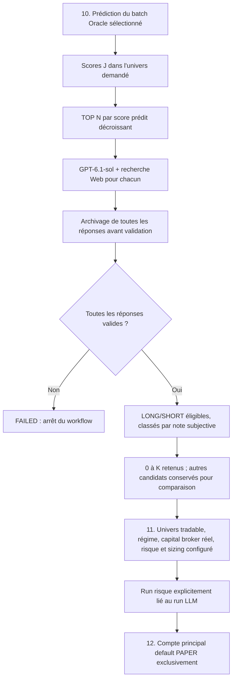

# Filtre directionnel Oracle → GPT / DeepSeek + Web → risque → PAPER

Depuis le 13 octobre, le filtre peut aussi recevoir les scores d'un
[Oracle parcours H20 raccordé](oracle_path_training.md), après contrôle des
folds et de la lineage. Ces scores prédisent l'amplitude, pas LONG/SHORT.
Le filtre directionnel reste indépendant et PAPER uniquement.

## 15 octobre 2026 — cache des news stockées, distinct du Web quotidien

Les analyses de recherche sur les articles déjà en base peuvent être conservées
et réutilisées dans les nouvelles tables `llm_news_analysis_*`. Les 221 réponses
des pilotes T1 2025/septembre 2026 ont été importées sans nouvel appel. Ce cache
préserve la distinction avis sur un article / avis sur un lot à une date.

**Il ne remplace pas la recherche Web prospective de cette page ni ses tables
`llm_directional_runs` / `llm_directional_assessments`.** Une réponse historique
ne constitue pas une vérification de la fraîcheur des informations du jour.
[Tables, anti-doublon, commandes de réutilisation et limites](../signals/news_analysis_cache.md).

## Choix du fournisseur — mise à jour du 11 octobre 2026

À la demande de l'utilisateur, `enabled: false` laisse désormais la case du
filtre **décochée par défaut**, quel que soit le fournisseur. L'activation
manuelle dans l'IHM reste possible. Une session déjà ouverte peut conserver
son choix précédent ; le décocher une fois dans cette session.

Le choix se fait dans `config.yaml`, section `llm_directional_filter` :

```yaml
provider: openai  # openai = GPT ; deepseek = analyse DeepSeek
model: gpt-6-luna  # Modèle OpenAI : analyse GPT ou collecte Web pour DeepSeek
api_key_env: OPENAI_API_KEY
deepseek_model: deepseek-flash
deepseek_api_key_env: DEEPSEEK_API_KEY
```

Changer uniquement `provider` permet de conserver les modèles et paramètres de
chaque branche. Les noms de variables désignent les secrets d'environnement,
jamais des clés à inscrire en YAML. GPT reste sélectionné par défaut. Les libellés
du filtre, des univers, du batch Oracle et des protections suivent le fournisseur
configuré ; le rapport d'une ancienne analyse indique son fournisseur **archivé**.

**DeepSeek ne remplace pas le moteur de recherche Web.** Sa documentation
[Responses API](https://api-docs.deepseek.com/api/create-response/) indique que
les outils intégrés sont ignorés. Le mode livré est donc **hybride** :

1. OpenAI effectue la recherche Web traçable avec la requête existante.
2. DeepSeek reçoit le contexte Oracle et la réponse Web archivée, puis produit
   sa propre décision JSON via Chat Completions.
3. La validation locale exige les mêmes identités, sources récentes réellement
   rencontrées, seuils, fenêtre prospective et protections PAPER.

Ce mode exige **OPENAI_API_KEY et DEEPSEEK_API_KEY**, et facture **les deux API**.
Le modèle DeepSeek est configurable ; `deepseek-flash` figure dans l'exemple
officiel [JSON Output](https://api-docs.deepseek.com/guides/json_mode/).
Le préflight vérifie son accès réel, pas un remplacement automatique.
DeepSeek n'ouvre pas les pages lui-même et ne reçoit pas leur texte intégral
certifié : il exploite les traces et la synthèse OpenAI, incluant l'avis préliminaire.
Il ne s'agit donc ni d'une recherche DeepSeek autonome, ni d'une comparaison
indépendante des fournisseurs. Aucun gain directionnel n'est démontré.

Les réponses des deux fournisseurs et la requête DeepSeek effective sont
archivées dans `llm_directional_assessments.response_json` ; la configuration
figée dans `llm_directional_runs.config_json` conserve le fournisseur et les deux
modèles. Les tables existantes suffisent, aucune migration n'est nécessaire.
Si DeepSeek échoue après la recherche, la réponse Web est conservée mais le run
ne publie aucun candidat. Une réponse tronquée, vide ou sans Web qualifiable
ne devient pas une décision exploitable. Pas de retry payant ni de fallback GPT.
La relecture reconstruite utilise les vrais RAW archivés, jamais des citations
ajoutées par DeepSeek. Les anciens runs sans champ `provider` restent GPT et
gardent leur contrat de requête existant.

Contrôle préalable, sans génération payante :

```powershell
python -m service.llm_directional.preflight --check-api
```

Cette commande consulte les métadonnées modèles, vérifie les clés sans les
afficher, les tables et le compte principal PAPER. Elle ne garantit pas un futur
appel réussi. Les étapes 10/11/12 et `us_pipeline` utilisent la même configuration.
Tests locaux simulés uniquement pour cette livraison : pas d'appel LLM payant,
pas d'ordre, pas de modification des données SQL ou des modèles Oracle.
Validation : **519 tests passent** (filtre, sources, archives, SHORT, protections,
dates US, workflow, batch et IHM). L'accès réel au modèle DeepSeek reste à
vérifier avec la clé de l'utilisateur ; aucun succès API réel n'est revendiqué.

**Test réel ultérieur du 11 octobre :** accès confirmé et comparaison autorisée
sur les 11 titres précédents, avec preuves Web partagées. GPT : 11 réponses valides,
1 LONG / 3 SHORT / 7 ABSTAIN. DeepSeek : 9 réponses valides, 1 SHORT / 8 ABSTAIN,
deux JSON tronqués par le budget de 6 000 tokens incluant le raisonnement.
Zéro candidat éligible, aucun risque/ordre. La branche DeepSeek est FAILED,
comparaison PARTIAL_FAILED ; son transport fonctionne mais le budget nécessite
une qualification avant usage opérationnel. [Comparatif détaillé](llm_gpt_deepseek_comparison_11.md).

<!-- doc-status:start -->
> Statut documentaire au 2026-10-10 — Guide courant : lire aussi les contrats transverses actualisés. Les inventaires générés localisent le code ; ils ne prouvent ni état en base ni réussite opérationnelle. [Référence actuelle](../ETAT_ACTUEL_IMPLEMENTATION.md).
<!-- doc-status:end -->

Implémentation du 8 octobre 2026. Marché US exclusivement. **Expérience prospective,
non validée économiquement : aucun gain directionnel ou rendement n’est garanti.**

## 1. Objectif et périmètre

### Date unique Oracle / GPT / risque / exécution — correctif du 10 octobre 2026

Le run manuel `20261010_124947_48e1fd11` utilisait le bon batch Oracle mais la
date du samedi 10 octobre : Oracle calculait zéro score et le filtre GPT
refusait une date hors séance. La commande Oracle ne recevait pas la date du
wrapper, et son retour d'erreur était alors affiché avec un code de succès.

Le parcours prospectif utilise désormais une **séance signal US unique** :

- samedi/dimanche/jour férié : séance précédente selon le calendrier NYSE ;
- aujourd'hui avant l'ouverture NYSE : séance précédente ;
- après minuit Paris alors que New York est encore la veille : date NY de la
  veille, puis résolution de sa séance ; aucun saut vers le nouveau jour Paris ;
- séance explicitement sélectionnée dans le passé : conservée, jamais avancée
  pour faire passer une analyse expirée ;
- séance courante pendant le marché : données non définitives, analyse bloquée
  avant la clôture ; une sélection future ne devient pas un signal du passé.

Exemple : samedi **10/10/2026** → signal **09/10/2026**, valide pour une analyse
Web prospective jusqu'avant l'ouverture de la séance suivante. Le calendrier
gère jours fériés, demi-séances et changement d'heure NY/Paris, sans règle
approximative « lundi–vendredi ».

La commande affichée et celle exécutée contiennent : date du wrapper
`--trade-date J`, Oracle `--universe-date J`, risque `--trade-date J`, exécution
`--date J`. Le registre fige la date au lancement ; le workflow la conserve.
La page Pipeline affiche la séance Oracle/GPT à côté de la commande LIVE.
La **date signal n'est pas la date de fill** : l'entrée broker peut être ultérieure.

Le wrapper revalide la fenêtre `clôture J ≤ maintenant < ouverture suivante`
**avant** le sous-processus Oracle et avant l'accès DB/broker. Il n'autorise
aucune recherche Web historique. Oracle-only renvoie un code non nul si le
calcul échoue ou produit zéro score ; GPT n'est alors pas appelé. La synthèse
Oracle quotidienne est limitée à J au lieu de réécrire tout l'historique.
Une date valide ne garantit pas la présence des cours, des features ou des
scores : les contrôles de couverture restent obligatoires.

11/12 exigent toujours l'identifiant exact d'une analyse réussie, sa date,
son compte PAPER, ses protections figées et le lien au run risque. Aucun
fallback « dernier run », aucune autorisation d'ordre liée au seul changement
de date. Aucune migration SQL ni réinstallation des tâches nécessaire ;
rafraîchir/redémarrer l'IHM si elle conserve le code chargé précédemment.

Vérification locale du correctif : **479 tests passent**, sans appel GPT ni
ordre broker. Couverture : week-end, jours fériés/demi-séances, pré-ouverture,
minuit Paris et changement d'heure, transmission des dates 10/11/12,
précontrôle avant calcul et arrêt sur zéro score Oracle. Deux tests existants
de `tests/test_ihm_pipeline_e2e.py` restent en écart, hors de ce correctif :
les clés du bloc sentiment et le défaut `margin` attendu comme `cash` par
le test. Ils ont été exclus du dernier passage vert ; leurs fonctions dans
`ihm/pages/_execution_center` et leur configuration n'ont pas été modifiées.
Ce contrôle local ne remplace pas la relance réelle de l'étape 10 ni ne
garantit la disponibilité des scores au 09/10/2026.

### Extension LONG/SHORT — 10 octobre 2026

`llm_directional_filter.allow_short: true` et `alpaca.accounts[id=default].long_only: false`
sont activés. Les comptes `test1/test2` restent LONG-only ; LIVE reste interdit.
Le compte principal n'est donc plus LONG-only **également dans les autres parcours
risque qui utilisent ce compte**. Aucune limite capital/exposition/positions ni
autorisation de régime n'a été augmentée par cette évolution.

Les 20 premiers scores Oracle sont analysés ; au maximum **3 candidats au total**
peuvent être retenus, dans n'importe quelle combinaison LONG/SHORT. Il ne s'agit
pas de 3 par côté. La note subjective reste non calibrée dans les deux sens.
L'autorisation SHORT est un opt-in configurable, jamais déduite du score Oracle.

Contrôles supplémentaires avant risque puis avant exécution : compte PAPER
autorisé par Alpaca (`shorting_enabled`), action active, `tradable`, `marginable`,
`shortable` et `easy_to_borrow` explicitement vrais. Absence, HTB ou erreur de
lecture : **arrêt**, aucun statut favorable inventé ni locate payant automatique.
Un candidat non empruntable fait échouer le passage, sans substitution implicite.
Les quantités SHORT sont entières, même si la case protections spécifiques est
décochée. Les cibles nouvelles doivent garder exactement le sens archivé par GPT.
Une position opposée ne peut pas être retournée implicitement ; les cibles hors
sélection peuvent seulement réduire une position existante du même sens.

SL SHORT : ordre **buy stop** à entrée × 1,07. Trailing SHORT : ordre **buy trailing**
au-dessus du plus bas suivi par le broker après activation. Avec le réglage local
15 %, une entrée à 100 et un SL à 107 autorisent la transition seulement lorsque
le cours est au plus 107/1,15 ≈ 93,0434. Le plafond confirmé par le broker doit
rester ≤107 ; sinon annulation confirmée puis réarmement, sans double rachat en
cas d'exécution pendant l'annulation. Une remontée pendant la transition réarme
également le SL original. La sortie séance 21 est un **buy-to-cover** MOO/market,
borné au reliquat réel du lot et à la quantité broker ; aucune vente supplémentaire.
Les gaps peuvent dépasser la perte théorique du SL : ce n'est pas une garantie de 7 %.

Le watcher relit désormais le côté du parent depuis les requêtes existantes,
y compris les lots SHORT et les quantités broker signées. Les formats SQL sont
inchangés : décisions/configuration en JSON, côtés des ordres déjà disponibles ;
**aucune migration SQL nécessaire**. Le reporting ajoute un rendement directionnel
brut signé pour SHORT, sans le présenter comme un backtest économique : frais,
emprunt, dividendes compensatoires et fills réels doivent être analysés séparément.

Le protocole passe à `oracle-web-directional-v2`. Les anciens runs v1 restent
archivés et leurs protections figées restent accessibles, mais ne sont pas
réutilisables pour une nouvelle étape risque/exécution : **relancer étape 10**.
Redémarrer l'IHM et le **service watcher local** pour charger le nouveau code ;
un watcher déjà démarré ne recharge pas ses modules automatiquement.
Le passage exécution contrôle aussi que le watcher local n'a pas démarré avant
la dernière modification des modules de protections : un ancien heartbeat sain
ne suffit pas, les nouveaux ordres sont bloqués jusqu'au redémarrage. Le watcher
continu est requis dès que SHORT est autorisé, même sans le profil spécifique.
Enchaîner ensuite 10 → 11 → 12 avec le même run, compte default PAPER.
Aucun ordre, appel GPT payant ou écriture SQL de production n'a été effectué
pendant la validation locale de cette extension.

Validation locale : **301 tests passent** (filtre, risque explicite mixte,
protections, SQL en mémoire, pipeline et démarrage du watcher), plus compilation
des modules/IHM modifiés. Les tests ne prouvent pas la rentabilité ni l'exécution
effective d'un SHORT sur le compte : les autorisations broker sont revérifiées
au moment du prochain passage réel PAPER.

Références : [schéma JSON structuré OpenAI](https://developers.openai.com/api/docs/guides/structured-outputs),
[règles d'emprunt Alpaca](https://docs.alpaca.markets/us/docs/margin-and-short-selling),
[limites de simulation PAPER](https://docs.alpaca.markets/us/docs/paper-trading).
Cette implémentation reste volontairement ETB-only même si d'autres possibilités
de locates sont proposées par Alpaca.

L’Oracle Extreme identifie une amplitude potentielle, pas le sens. Le filtre cherche
une thèse LONG ou SHORT documentée parmi ses premiers candidats. Il ne remplace ni le moteur
de risque, ni le sizing, ni les protections. Il ne crée aucune prédiction Per-Symbol
et n’écrit pas de fausses probabilités directionnelles dans `model_predictions`.



**N = `oracle_top_n` et K = `max_selected`, configurables dans `config.yaml`.**
Défauts du composant : N=10, K=5 ; configuration locale actuelle : N=20, K=3.
Ce sont des nombres de titres, pas des pourcentages.
Le classement initial utilise uniquement `proba_extreme DESC, symbol ASC` ; il
n’utilise jamais les rendements futurs ni un classement Oracle réalisé.
Le filtre n’ajoute pas implicitement une intersection ATR : cette expérience
porte sur les N premiers scores Oracle du périmètre choisi. ATR demeure qualifié
par le risque ; le sizing/protections historiques l'utilisent lorsque le profil
spécifique ci-dessous est désactivé.

## 2. Configuration

```yaml
llm_directional_filter:
  enabled: true
  model: gpt-6.1-sol
  api_key_env: OPENAI_API_KEY
  default_symbol_source: universe-file:univers_filtred_tradable.txt
  default_oracle_batch_id: model-factory-20261003082853-e98332
  oracle_top_n: 20
  max_selected: 3
  min_oracle_coverage_ratio: 0.90
  min_confidence: 0.75
  min_sources: 2
  max_source_age_days: 30
  max_run_age_hours: 24
  timeout_seconds: 120
  max_output_tokens: 6000
  max_tool_calls: 5
  account_id: default
  horizon: 20
  allow_short: true
  protections:
    enabled: true
    stop_loss_pct: 0.07
    exit_session: 21
    trailing_stop_pct: 0.15
```

`enabled` fournit le défaut IHM et autorise la CLI directe d’analyse. La checkbox
est cochée par défaut dans la configuration actuelle, sans lancement automatique.
Une valeur déjà mémorisée dans la session IHM reste prioritaire.
La checkbox
IHM est un opt-in explicite : elle peut activer une campagne ponctuelle même si
ce défaut reste false. Elle n’active pas le batch planifié `us_pipeline`.
Une campagne enregistre sa configuration entière : changer N/K demain ne change
pas rétrospectivement les sélections enregistrées aujourd’hui.

Les deux champs `default_symbol_source` et `default_oracle_batch_id` préremplissent
les listes « Univers Oracle → filtre GPT » et « Batch Oracle → filtre GPT ».
Les choix manuels restent prioritaires dans la session IHM. Après changement du
YAML, une sélection déjà mémorisée n'est pas écrasée : sélectionner la nouvelle
valeur ou ouvrir une nouvelle session. Le batch dédié remplace, pour ce flux
uniquement, les anciens choix LIVE/BACKTEST ; prédiction et filtre utilisent
toujours le même identifiant. Un univers configuré absent bloque avec un message,
sans substitution silencieuse. Un batch sans artefact Oracle valide reste rejeté
par les contrôles existants. Le filtre désactivé conserve le fonctionnement habituel.

| Paramètre | Rôle / garde-fou |
|---|---|
| `oracle_top_n` | Entier 1–100, borne du nombre d’appels d’analyse, un par titre |
| `max_selected` | Entier 0–N, plafond de sélection ; zéro désactive toute sélection sans effacer l’audit |
| `min_oracle_coverage_ratio` | Fraction minimale de l’univers avec un score Oracle exact pour J ; évite un TOP N issu d’un import partiel |
| `min_confidence` | Seuil d’une **note subjective non calibrée** ; 0,75 ne signifie pas 75 % de chances du mouvement prévu |
| `allow_short` | Autorise SHORT, défaut du composant false, activé localement. Le plafond K est commun aux LONG et SHORT, pas doublé. |
| `min_sources` | Nombre minimal d’URL distinctes, réellement rencontrées par la recherche et datées récemment |
| `max_source_age_days` | Âge maximal des dates de publication déclarées dans la réponse |
| `max_run_age_hours` | Expiration du résultat pour risque/exécution, au plus 48 h |
| `timeout_seconds` | Limite de lecture HTTP par appel, pas durée totale de la campagne |
| `max_output_tokens` | Budget maximal de sortie par titre, pas budget monétaire global |
| `max_tool_calls` | Borne des appels d’outil pour chaque réponse |
| `account_id` | `default` seulement, avec mode réellement PAPER dans le registre Alpaca |
| `horizon` | Horizon directionnel demandé, vérifié contre l’artefact Oracle ; H20 par défaut |

La clé est lue exclusivement dans `OPENAI_API_KEY`. Sa valeur n’est ni affichée,
ni placée dans les commandes, ni stockée en base. Aucun modèle de remplacement
n’est choisi automatiquement si `gpt-6.1-sol` n’est pas accessible au projet API.

## 3. Informations fournies au LLM et recherche Web

Pour chaque titre : symbole, identité locale (`company_name`, exchange), date J,
rang et score Oracle, horizon, et jusqu’à 21 clôtures connues à J. Le prompt impose
la vérification de l’identité, une thèse directionnelle, les risques contradictoires,
les catalyseurs et les sources. Les publications d’émetteurs/SEC sont privilégiées.

Le seul outil exposé au modèle est `web_search` de l’API Responses. Le modèle
n’a aucun accès à Alpaca, SQL, au terminal, aux identifiants ni aux ordres. Les
instructions contenues dans les pages Web sont traitées comme données non fiables.
La sortie doit respecter un schéma JSON strict et choisir LONG, SHORT ou ABSTAIN.
Une absence d'argument haussier n'est pas une thèse baissière. Le prompt exige
des preuves de baisse et l'examen du risque de squeeze ; l'empruntabilité ne
peut jamais être déclarée par GPT à la place du broker.

Une réponse LONG/SHORT n’est éligible que si (SHORT exige aussi `allow_short: true`) :

1. le statut API est `completed`, avec au moins une recherche Web terminée ;
2. le JSON respecte le schéma et le symbole demandé ;
3. l’identité est déclarée vérifiée, sans valeur numérique non finie ;
4. la note atteint `min_confidence` ;
5. au moins `min_sources` URL distinctes sont récentes et présentes parmi les
   sources/citations réellement renvoyées par l’outil ;
6. les preuves retenues sont récentes et non futures : horodatage avec fuseau,
   ou date seule dont l'intervalle complet de publication possible est dans
   la fenêtre `max_source_age_days` (protocole v4, section 13) ;
7. aucune URL citée dans l'analyse n'est non traçable ou invalide : ces URL sont
   exclues et bloquent conservativement l'éligibilité de ce titre.

Une réponse ABSTAIN reste une réponse valide même si les sources récentes sont
insuffisantes. Une date imprécise ne devient pas une erreur technique : elle reste
archivée ; une date seule n'est comptée que si son intervalle complet est qualifié.
Un LONG/SHORT
sans preuves suffisantes est une abstention de sélection (`ABSTAIN_UNQUALIFIED`),
sans modifier la décision brute du modèle. Une réponse techniquement invalide fait échouer **tout le run**,
au lieu de trader silencieusement un sous-ensemble incomplet.

Les LONG et SHORT éligibles sont triés ensemble par note décroissante, puis rang Oracle croissant,
puis symbole. Les K premiers sont retenus au maximum. Il n’y a jamais obligation
d’atteindre K : 0, 1 ou 2 candidats peuvent être le résultat normal.

## 4. Temps, PIT et limites de recherche

Le filtre Web est **prospectif uniquement** : l’analyse doit commencer après la
clôture de la séance J et être terminée strictement avant l’ouverture de la
séance US suivante. Minuit (Paris ou New York) ne change pas la date de séance
figée dans le workflow. Les cours J doivent être disponibles. Le calendrier
NYSE fiable est requis, sans approximation lundi-vendredi : week-ends, jours
fériés, clôtures anticipées et changements d’heure sont pris en compte.

Exemple : un batch lancé le 8 octobre 2026 à 23 h Paris conserve J=2026-10-08
à 8 h Paris le 9 octobre. La fenêtre se ferme à l’ouverture US suivante,
le 9 octobre à 15 h 30 Paris. Une analyse qui dépasse cette ouverture est
marquée échouée, sans sélection publiée. Les informations Web éventuellement
publiées pendant la nuit restent des informations observées à l’heure réelle
du calcul, pas des informations prétendument connues à la clôture J.
La durée de validité configurée du run GPT et les contrôles exacts de date/compte
à l’étape risque restent inchangés.
Le filtre refuse une commande de prédiction historique ou Oracle shadow.
Il ne reconstitue pas les informations qu’un LLM aurait connues en 2024 ou 2025.

`observed_at`, début et fin d’analyse sont enregistrés en UTC. Les dates de
publication trouvées par le LLM sont des **déclarations non certifiées**, signalées
par `source_timestamps_verified=false`. Stocker une citation et une date ne
certifie ni son antériorité originale, ni l’exhaustivité du contenu Web.
L’information n’est utilisable qu’après réception/finalisation effective du run.

Une sélection périmée, datée du futur, partielle ou incohérente est rejetée.
Les conventions existantes de décision J et entrée à la séance suivante restent
applicables ; l’option ne force jamais un ordre après clôture. Un ordre peut être
bloqué/reporté par le moteur d’exécution et sa fenêtre de soumission.

## 5. Tables et reprise

Migration : `alembic/versions/0093_llm_directional.py`.
SQL de référence : `database/sql/ml/llm_directional_filter.sql`.
Les trois tables résident dans **alpha_trade**, jamais dans les bases FR/CN.

| Table | Contenu |
|---|---|
| `llm_directional_runs` | Batch, J, compte, protocole, configuration et univers figés, hash des entrées, début/fin, statut, liste finale, erreur, réservation risque, identifiant risque et réservation exécution |
| `llm_directional_assessments` | Tous les titres analysés, rang/score, requête exacte, réponse brute et hash, réponse structurée, sources, motif/erreur, statut et sélection finale |
| `llm_directional_evaluations` | Mesures réalisées séparées H5/H10/H20, sélection ou rejet, dates entrée/sortie, rendement brut ajusté, rendement depuis J, décile qualifié si disponible et lineage |

Les réponses sont **persistées individuellement dès réception, avant parsing**.
Seuls les champs dérivés changent ensuite de RECEIVED à VALID/FAILED. Les corps
bruts ne sont pas remplacés. La finalisation du run et le marquage des retenus
sont transactionnels. Un arrêt laisse les réponses déjà reçues consultables,
mais un run RUNNING/FAILED n’est jamais servable.

L’application refuse de réutiliser le même `run_id` pour une nouvelle analyse.
Elle ne relance pas automatiquement un appel API après timeout : il pourrait
déjà être facturé. Un nouveau run volontaire crée de nouvelles observations.
Les réservations risque/exécution empêchent un double lancement automatique.
Après un crash lors d’un envoi d’ordre, vérifier l’état broker avant toute reprise ;
la réservation n’est pas effacée automatiquement.

Les hashes permettent des contrôles de cohérence, pas une garantie d’inaltérabilité
contre un administrateur SQL. Conserver les sauvegardes et limiter les droits SQL.
Les archives contiennent le retour API et ses citations, pas une copie intégrale
de toutes les pages Web. Elles ne donnent pas de droit de redistribution des sources.

## 6. Risque et exécution : pas de fausse probabilité

Le chemin `oracle_web_llm_directional` réutilise le PortfolioBuilder et ses contrôles
capital/slots/secteur/corrélation/régime/ATR. Il exige un snapshot broker réel
PAPER (equity, cash, buying power, positions et ordres ouverts), et non une
estimation issue des anciens ordres de risque.

Le prix, l’ATR et l’ADV du jour doivent être qualifiés ; le régime doit être du
jour et son snapshot récent. L’univers tradable et les gates de risque/MLOps
restent autoritaires : un titre sélectionné par GPT peut être refusé ensuite.
Les secteurs actuellement disponibles restent ceux utilisés par l’application.

La note LLM alimente le classement explicite avec
`score_source=llm_confidence_uncalibrated`. Elle n’alimente pas `P(LONG)/P(SHORT)`, le Kelly
ou une espérance de rendement artificielle. Kelly et un optimiseur exigeant un
edge directionnel qualifié sont interdits dans cette voie.

La CLI risque reçoit le `llm_filter_run_id` exact. Son vrai `risk_run_id` est lié
en base avant toute exécution. L’étape 12 reçoit ce même identifiant risque et
n’effectue aucun fallback vers les dernières cibles connues.
Avant soumission, les cibles doivent correspondre au compte/date et à la sélection ;
les titres déjà détenus hors sélection ne peuvent pas être augmentés par cette voie.
Les protections des positions existantes restent du ressort du lifecycle/watcher.

LIVE, les autres comptes, `allow_outside_rth`, le rééquilibrage automatique et un
plan d’exécution externe sont refusés. Aucun LLM ne choisit les quantités ou les stops.

### 6.1. Protections spécifiques GPT — 9 octobre 2026

Dans les paramètres ML de Pipeline, sous la case GPT, apparaît la case
**« 🛡️ Protections spécifiques GPT — SL / sortie temporelle / trailing »**.
Elle est cochée par défaut (`protections.enabled: true`) et n'est prise en compte
que si le filtre GPT est activé. Elle s'applique aux nouvelles entrées LONG et SHORT du
compte `default`, marché US, mode PAPER. Elle ne transforme pas les positions
existantes, les achats manuels ou les ordres FR/CN/LIVE.

| Réglage | Comportement du profil |
|---|---|
| `stop_loss_pct: 0.07` | Stop initial à 7 % sous l'entrée LONG, ou au-dessus de l'entrée SHORT, sur le prix moyen **réellement exécuté**, arrondi au centime. Sizing avec cette distance ; contrôles capital/liquidité/régime conservés. |
| `exit_session: 21` | Vente LONG / rachat SHORT, gagnant ou perdant : séance d'entrée = 1, sortie à l'ouverture de la 21e séance NYSE, pas 21 jours calendaires. |
| `trailing_stop_pct` | Sous le plus haut pour LONG, au-dessus du plus bas pour SHORT, suivi par le broker **après activation**. Défaut composant 20 %, configuration locale 15 %. Jamais de desserrement du SL initial. |

Exemple entrée 100 $ : SL 93 $. Le trailing 20 % peut prendre le relais lorsque
le cours atteint au moins 116,25 $ (116,25 × 0,80 = 93), pas au trigger 1R
historique. Le watcher recontrôle le prix après annulation du SL ; si le cours
a reculé, il réarme le SL initial au lieu de le desserrer. La référence est le
prix exécuté du parent, pas le prix moyen courant d'autres achats du même titre.
Le plancher effectivement confirmé par le broker est également contrôlé :
s'il est plus bas que le SL initial ou absent, le trailing est annulé avec
confirmation, puis le SL est réarmé (une exécution pendant l'annulation interdit
un nouvel ordre de vente). Les rejets certains et les états réseau inconnus sont
traités séparément.
Le plus haut antérieur à l'activation n'est pas reconstitué rétrospectivement.
Les réglages expérimentaux par signal/ATR ne remplacent pas ce trailing spécifique.
Les exemples ci-dessus utilisent le défaut 20 % ; la valeur locale peut être
différente (`0.15` au dernier contrôle), sans être écrasée par le code.

Aucun ordre limite de TP de prix n'est créé pour ce profil. Le garde-fou du watcher
ne recrée pas non plus un ancien TP à 7 %/ATR et ne considère pas cette absence
intentionnelle comme un motif de duplication du SL. Les quantités sont entières
pour cette voie (protections GTC et ordre d'ouverture), même si les fractions
restent autorisées dans la configuration historique.
La préférence historique `swing_only` ne retarde pas l'armement de ce SL au
lendemain ; seules les protections de ces nouvelles entrées GPT sont concernées,
sans changer les contraintes du compte ou les règles d'entrée.

**Sortie à l'ouverture :** le watcher programme un ordre marché d'ouverture
Alpaca (`market`, `time_in_force=opg`) uniquement pour la séance immédiatement
suivante, à partir de 19 h New York ou avant 9 h 28 le matin de la sortie.
Les heures New York/Paris et leurs changements d'heure sont gérés par le
calendrier strict. Les protections sont annulées et leur état est confirmé
avant de réserver/envoyer la vente ; un stop exécuté pendant l'annulation bloque
une seconde vente. Voir les [conditions officielles Alpaca](https://docs.alpaca.markets/us/docs/orders-at-alpaca).

Le **service watcher doit rester actif et le PC allumé**, notamment avant
l'ouverture cible : une simple exécution quotidienne des étapes 10–12 ne suffit
pas à assurer cette échéance. Dans Pipeline → **Watcher protections**, utiliser
**« Démarrer service local »**, compte principal, avant l'étape 12 ;
`Run watcher once` et `--auto-watcher` en mode once ne suffisent pas.
L'étape 12 bloque ce profil si le heartbeat du service est absent/périmé,
avant toute réservation exécution ou soumission. Un service Windows existant
avec heartbeat valide convient également. Le contrôle au lancement ne garantit
pas que le PC restera disponible jusqu'à la séance cible.
Si l'ouverture est manquée, le watcher soumet une
sortie marché de rattrapage pendant une séance ouverte ; elle est marquée
`LATE_MARKET`, jamais présentée comme une exécution au prix d'ouverture.
Un ordre d'ouverture expiré/rejeté ne réutilise pas la même clé de soumission
que ce rattrapage. Un état réseau ambigu est réservé en base et impose une
réconciliation/revue avant nouvelle tentative ; pas de fallback silencieux
vers un trailing moins protecteur. Un SL déjà franchi lors d'un réarmement
déclenche une sortie marché plutôt qu'un stop incohérent au-dessus du cours.

Les paramètres et le choix de la case sont figés à l'étape 10 dans
`llm_directional_runs.config_json.protections`, puis retrouvés par le `risk_run_id`
exact et le symbole sélectionné pour les étapes 11/12 et le watcher, y compris
après redémarrage. Le journal d'exécution conserve les demandes/observations et
la politique/délai dans les événements. **Aucune nouvelle table ni migration
n'est nécessaire.** Changer le YAML ne réécrit pas les protections d'un run
déjà publié. Changer la case entre 10 et 11/12 bloque : garder le même choix,
ou effectuer une nouvelle analyse. Les anciennes analyses sans cette clé
gardent leur politique historique.

Case décochée, ou filtre GPT décoché : comportement historique inchangé
(SL ATR, TP de prix, trailing et time-stop selon les autres réglages).
Un SL de 7 % et un trailing ne garantissent pas une perte plafonnée : gaps,
slippage, suspensions, annulations ou indisponibilité du service restent possibles.

## 7. Utilisation IHM

1. Redémarrer l’IHM après installation du code. Choisir le marché US.
2. Dans Pipeline → paramètres ML, cocher **« Filtrage GPT + recherche Web après
   Oracle — PAPER uniquement »**. Les valeurs N/K sont affichées depuis le YAML.
   La case de protections spécifiques placée dessous est cochée par défaut ;
   la décocher **avant l'étape 10** pour conserver les protections historiques.
3. Sélectionner explicitement le batch Oracle et l’univers de prédiction, pour J,
   sans plage historique et sans Oracle shadow. Choisir le compte principal.
4. Laisser Kelly, hors séance, LIVE et rééquilibrage automatique désactivés.
5. Lancer un workflow comprenant 10 → 11 → 12 : un identifiant LLM unique est
   partagé entre les trois étapes. L’étape 12 utilise PAPER même si le mode global
   affiché était simulate ; LIVE est refusé, jamais converti silencieusement.
6. Pour lancer les étapes séparément : copier le `run_id` renvoyé par l’étape 10
   dans le champ **Identifiant analyse LLM** avant 11 puis 12. Ne pas utiliser auto
   pour risque/exécution. Réutiliser un run déjà consommé échoue volontairement.
7. Dans **« Audit des sélections GPT + Web — PAPER »**, saisir l’identifiant pour
   consulter tous les titres, les motifs, sources, configuration et évaluations.

Le workflow s’arrête en cas d’échec. Une abstention complète n’envoie aucun nouvel
ordre. Les listes `config.yaml → us_pipeline.steps` / `steps_friday` définissent
les étapes du batch quotidien (de 1 à 14). Le filtre GPT n'est pas activé
implicitement par ces listes ou les cases de la session IHM ; voir le guide
`doc/operations/us_pipeline.md` pour le mode et le plan configurés.

## 8. Commandes et vérification

Contrôle sans génération GPT ni ordre :

```powershell
python -m service.llm_directional.preflight --check-api
```

Ce contrôle utilise seulement GET pour vérifier l’accès au modèle. Il n’établit
pas que Web Search + sortie structurée fonctionnent en réel : cela nécessitera
une première analyse prospective, avec consommation API explicite.

Après activation YAML pour une analyse CLI directe :

```powershell
python -u -m service.llm_directional.runner --batch-id BATCH_ORACLE --trade-date YYYY-MM-DD --symbol-source universe-file:univers_filtred_tradable.txt --capital-preset-key capital_2001_5000
python -m service.llm_directional.report --run-id RUN_LLM
python -m service.llm_directional.evaluate --run-id RUN_LLM
```

Les commandes combinées prédiction/filtre, risque et exécution sont générées par
l’IHM ; ne pas lancer directement `run_execution.py` sans identifiant risque lié.

## 9. Évaluation ultérieure

L’évaluateur traite **tous les candidats archivés**, retenus et rejetés : comparaison
du filtre contre le TOP N Oracle initial, pas seulement des gagnants sélectionnés.
Il attend les horizons matures, vérifie des barres complètes/non remplies et des
prix positifs, puis écrit progressivement uniquement sa table d’évaluation.
Une seconde exécution saute les évaluations déjà enregistrées.

`return_pct` : entrée à l’open J+1 ajusté sur l’échelle de `adj_close`, sortie à
la clôture ajustée J+H. `signal_return_pct` : clôture ajustée J → J+H.
Ces mesures sont brutes, fondées sur les ajustements fournisseur, sans frais,
slippage, taxes, contraintes de portefeuille ni lifecycle ; ce n’est pas un backtest
économique validé. Les dates J+H sont des séances NYSE, pas des jours calendaires.
`oracle_decile` n’est renseigné qu’à partir d’un label du même batch/horizon, de
qualité valide et effectivement disponible ; sinon il reste NULL, jamais inventé.

Une promotion nécessite des campagnes prospectives suffisantes, une comparaison
aux rejets/baseline, des résultats par période/symbole/régime et un test économique
ultérieur. Ne pas réajuster les seuils sur ces observations puis les appeler OOS.

## 10. État de livraison et limites opérationnelles

Les tables ont été créées sans modifier les tables métier existantes. Le marqueur
Alembic existant était `0088_us_fact_instrument_constraints` : il n’a pas été avancé
artificiellement au-delà des migrations intermédiaires. La migration 0093 est
idempotente pour les tables déjà présentes ; traiter la chaîne historique séparément.

Compte principal vérifié : `default`, PAPER. Après actualisation de l'accès API,
le contrôle du 8 octobre 2026 retourne **HTTP 200 pour `gpt-6.1-sol`** : le précédent
blocage `401 invalid_api_key` est levé. Ce GET de métadonnées ne valide pas encore
un appel Responses avec recherche Web. Ne jamais transmettre la clé dans le chat.
Les racines de certificats Windows sont prises en compte sans désactiver TLS.

Tests : mocks API/broker et base SQLite isolée. Aucun appel d’analyse GPT payant,
aucun entraînement et aucun ordre n’ont été lancés pendant l’implémentation.
Vérification du 8 octobre 2026 : **250 tests ciblés passent**, couvrant le filtre,
les commandes Pipeline, le risque et le portefeuille Oracle. Rapport automatisé :
`artifacts/research/llm_directional_implementation/tests.xml`. La compilation des
modules modifiés et le contrôle de cohérence du diff passent également.
L’accès effectif au modèle, la facturation et un premier cycle PAPER restent à
valider avec une clé valide et des prédictions de la séance courante.

## 11. Sources techniques et points d’entrée

### Lancement manuel de ML Predict et tables GPT (9 octobre 2026)

Le bouton « 10. ML Predict » peut être lancé sans succès préalable de l’étape 9
ni de l’entraînement optionnel T1 : il peut utiliser des modèles et données déjà
disponibles. Les verrous de concurrence, de workflow actif et de protection LIVE
restent applicables. Les contrôles du filtre GPT (PAPER, fenêtre clôture J/ouverture suivante,
données et batch Oracle disponibles) ne sont pas contournés. L’ordre du workflow
et les prérequis des étapes risque/exécution ne changent pas.

Le filtre GPT écrit uniquement dans la base US `alpha_trade` :

- `llm_directional_runs` : configuration, entrées, état, sélection et liens avec
  les étapes risque/exécution ;
- `llm_directional_assessments` : requête/réponse brute, analyse, sources Web,
  décision et sélection par symbole ;
- `llm_directional_evaluations` : rendements réalisés, alimentés ultérieurement
  par l’évaluation, pas pendant l’analyse GPT.

GPT ne remplace pas les scores Oracle. La prédiction ML préalable conserve ses
propres écritures habituelles ; ces trois tables concernent le filtre et son audit.

- [OpenAI Responses Web Search](https://developers.openai.com/api/docs/guides/tools-web-search)
- [OpenAI Structured Outputs](https://developers.openai.com/api/docs/guides/structured-outputs)
- [Modèle GPT-6.1-sol](https://developers.openai.com/api/docs/models/gpt-6.1-sol)
- `service/llm_directional/config.py` : validation des paramètres.
- `openai_client.py`, `validation.py` : transport, prompt, schéma et décisions.
- `repository.py`, `runner.py` : stockage individuel et orchestration de l’analyse.
- `pipeline.py`, `risk_adapter.py` : corrélation des trois étapes et voie PAPER.
- `report.py`, `evaluate.py`, `preflight.py` : audit, mesures différées et contrôle.
- `ihm/services/pipeline_runner.py`, `process_registry.py` : commandes et workflow.
- `risk_management/cli.py`, `portfolio_builder.py` : réutilisation du moteur réel.
- `tests/test_llm_directional_filter.py` : tests de la nouvelle fonctionnalité.

## 12. Dates imprécises, abstentions et erreurs techniques — correctif du 10 octobre 2026

Cette section décrit le premier correctif **v3**, remplacé pour les nouvelles
analyses par le **v4** décrit en section 13. Les résultats historiques v3 ne sont
pas réécrits.

Le protocole `oracle-web-directional-v3` distingue désormais la qualité des
preuves de la validité technique de la réponse. Aucun seuil, modèle, compte ou
paramètre de risque n'est changé par ce correctif.

- Date seule, sans heure (`2026-10-07`) : conservée exactement, classée `date_only`.
- Heure sans fuseau : conservée exactement, classée `missing_timezone`.
- Date absente ou illisible : conservée comme telle, non qualifiée.
- Date future ou trop ancienne : non comptée dans `fresh_source_count`.
- Horodatage précis et récent : compte une fois par URL distincte ; reste une
  déclaration non certifiée PIT (`source_timestamps_verified=false`).
- URL absente des sources/citations de la recherche terminée, ou URL invalide :
  exclue de `sources`, conservée dans `excluded_sources` et la réponse brute.
  Sa présence empêche toute sélection directionnelle du titre, même si d'autres
  sources sont datées. Elle ne transforme pas une réponse ABSTAIN en erreur technique.

Le prompt interdit d'inventer une heure ou un fuseau. `published_at` n'est jamais
complété par une heure de minuit ni par le fuseau de collecte.
`source_qualifications` conserve le statut de chaque preuve ; `selection_blockers`
explique l'inéligibilité. Ces champs dérivés sont stockés dans `assessment_json`
et visibles dans le rapport d'audit ; aucune migration SQL n'est nécessaire.

`assessment_outcome` distingue `ELIGIBLE`, `ABSTAIN` (décision explicite du modèle)
et `ABSTAIN_UNQUALIFIED` (LONG/SHORT déclaré mais non sélectionnable). Les trois
issues sont techniquement `VALID`. Un run ne contenant que des abstentions est
`COMPLETED`, avec zéro candidat sélectionné et zéro échec ; aucune nouvelle entrée
n'est publiée. Les compteurs `abstained_count`, `eligible_count`,
`excluded_source_count` et `unqualified_source_count` sont distincts des erreurs.
Une erreur HTTP/transport, une réponse incomplète/refusée, l'absence de recherche
terminée, un JSON/schéma invalide ou une identité non vérifiée restent bloquants
pour l'ensemble du run.

La relecture **sans appel API et sans écriture SQL** du run
`llm-820db154cbfa4f23a6ac214cc8ce9434` donne 20 abstentions valides et zéro titre
éligible. Parmi les 111 références : 51 dates seules, 47 dates absentes,
4 URL non traçables exclues, 6 horodatages récents déclarés et 3 trop anciens.
La correction ne crée donc pas de signal LONG/SHORT sur ces réponses.

Le statut historique `FAILED`, les réponses brutes, leurs empreintes et les
requêtes de ce run restent inchangés. Les anciens protocoles ne sont pas promus
automatiquement aux étapes 11/12 : la validation avant risque exige le protocole
courant et la requête exacte. Redémarrer l'IHM pour charger le correctif avant
une future analyse prospective ; ne pas réinterpréter un ancien run pour trader.

Validation locale : **211 tests ciblés passent** (filtre, abstentions, traçabilité,
SHORT, protections, dates et commandes historiques), avec API/broker simulés et
base SQLite isolée. Rapport :
`artifacts/research/llm_directional_implementation/evidence-v3-tests.xml`.
Aucun nouvel appel GPT, aucun ordre ni aucune écriture en base réelle pendant
cette validation. Les réglages utilisateur de `config.yaml` sont préservés.

## 13. Dates calendaires et pages ouvertes — protocole v4 et diagnostic des 11 titres

Le protocole `oracle-web-directional-v4` corrige deux restrictions excessives :

- Une URL exacte provenant d'une action `open_page` ou `find_in_page` **terminée**
  est désormais traçable, au même titre que les sources/citations renvoyées.
  Une action échouée ou en cours ne suffit pas. Une URL voisine ou inventée reste
  exclue. Contrat officiel :
  [OpenAI Web search — output et citations](https://developers.openai.com/api/docs/guides/tools-web-search).
- Une date seule `YYYY-MM-DD` n'est pas transformée en horodatage. Elle est
  conservée exactement. On construit uniquement les **bornes de son intervalle
  possible**, en couvrant les fuseaux UTC−12 à UTC+14 : début du jour UTC moins
  14 heures, fin du jour UTC plus 12 heures (borne finale exclusive).
  Ces 50 heures doivent être **entièrement** comprises entre collecte moins
  `max_source_age_days` et collecte pour compter comme `fresh_date_claim`.

Les bornes sont archivées dans `source_qualifications` sous
`possible_publication_start_utc` et `possible_publication_end_utc_exclusive` ;
ce ne sont pas des heures de publication attestées. Un intervalle chevauchant
une limite est `date_only_ambiguous` et ne compte pas. Un intervalle entièrement
trop ancien/futur est `stale_date_claim`/`future_date_claim`. Une heure précise
sans fuseau reste non qualifiée. Les dates absentes ou invalides ne comptent pas.

`fresh_source_count` compte les URL distinctes qualifiées à la précision horaire
ou journalière. Cela reste une qualification **des déclarations du modèle**,
pas une vérification indépendante des publications ni une certification PIT.
`source_timestamps_verified=false` reste inchangé. Le prompt distingue la date
de publication d'un article des dates de prix, d'événements futurs ou de mise à
jour d'une page. Le seuil de confiance, le modèle et les protections ne sont pas
assouplis.

### Run parent et sélection bornée

Run parent : `llm-bc155d0d71484217b0bdc98cd9e06c7d`, modèle `gpt-6-luna`,
séance signal 9 octobre 2026, 100 analyses VALID, protocole v3. Décisions brutes :
89 ABSTAIN, 3 LONG (PENG, ICHR, CLS) et 8 SHORT
(SSTK, FICO, QFIN, FMC, CWH, ABR, APP, HUBG). Les 11 décisions directionnelles
ont une confiance de 0,61 à 0,72, sous le seuil de 0,75.

La requalification locale des anciennes réponses ne change aucune ligne du
parent et ne rend aucun de ces 11 titres éligible : le seuil de confiance suffit
encore à les exclure. PENG, ICHR et APP disposent désormais d'au moins deux URL
récentes déclarées, sans URL exclue ; leur seul blocage restant est la confiance.
Une des quatre références de HUBG est effectivement ouverte et reconnue, les
autres URL non traçables restent exclues.

### Nouvelle analyse autorisée, recherche uniquement

À la demande de l'utilisateur, une nouvelle analyse est limitée à ces **11 titres**,
avec le même modèle et les paramètres archivés du parent. Les prix, le rang et
les scores Oracle d'entrée sont conservés ; le nouveau modèle ne reçoit pas ses
précédentes décisions, pour limiter l'ancrage. Les contrôles de la fenêtre
prospective sont maintenus. Le service ne relance ni Oracle ni les étapes 11/12.

Identifiant : `llm-research-11-20261010-v4`. Réponses et requêtes brutes sont
archivées dans `llm_directional_runs` et `llm_directional_assessments`, sans
écraser le parent. Le snapshot contient `research_only=true` et `parent_run_id` ;
`qualified_selection` refuse tout passage de ce run au risque/exécution,
même si certains titres deviennent éligibles à la recherche.

Points d'entrée : `service/llm_directional/research_rerun.py`. Commande bornée :

```powershell
python -u -m service.llm_directional.research_rerun --parent-run-id llm-bc155d0d71484217b0bdc98cd9e06c7d --symbols SSTK,FICO,PENG,QFIN,FMC,ICHR,CWH,ABR,CLS,APP,HUBG --run-id llm-research-11-20261010-v4 --output-dir artifacts/research/llm_directional/requalification-11-20261010-v4
```

**Ne pas relancer automatiquement cette commande** : le même identifiant est
refusé avant les appels ; choisir un nouvel identifiant nécessite une nouvelle
autorisation pour éviter de consommer des appels payants en double. Le service
ne fait pas de retry implicite après un timeout.

Suivi : `run.log`, puis `report.json` et `baseline.json` dans le répertoire ci-dessus.
La sélection a été faite après observation du premier run : ce diagnostic ne
mesure ni la performance directionnelle ni un avantage économique OOS.
Ne pas promouvoir les éventuels changements de confiance comme un gain prédictif.

### Résultat de la réanalyse du 10 octobre 2026

Run `llm-research-11-20261010-v4` **COMPLETED** : 11 réponses VALID archivées,
zéro erreur technique, zéro candidat éligible, zéro passage au risque/exécution.
Début 19:41:50, fin 19:46:44 (Paris). Modèle `gpt-6-luna`, confiance minimale 0,75,
deux URL récentes distinctes requises : paramètres inchangés.

| Symbole | Premier avis | Nouvel avis | Nouvelle confiance subjective | URL récentes qualifiées | Retenu |
|---|---|---|---:|---:|---|
| SSTK | SHORT | SHORT | 0,61 | 0 | Non |
| FICO | SHORT | ABSTAIN | 0,72 | 2 | Non |
| PENG | LONG | LONG | 0,66 | 2 | Non |
| QFIN | SHORT | SHORT | 0,59 | 1 | Non |
| FMC | SHORT | SHORT | 0,66 | 2 | Non |
| ICHR | LONG | ABSTAIN | 0,76 | 2 | Non |
| CWH | SHORT | SHORT | 0,66 | 2 | Non |
| ABR | SHORT | SHORT | 0,66 | 1 | Non |
| CLS | LONG | ABSTAIN | 0,76 | 2 | Non |
| APP | SHORT | ABSTAIN | 0,74 | 4 | Non |
| HUBG | SHORT | SHORT | 0,72 | 4 | Non |

Décisions brutes : **1 LONG, 6 SHORT, 4 ABSTAIN**. Les sept avis directionnels
restent tous sous 0,75. Huit analyses ont désormais au moins deux sources récentes
qualifiées ; les dates ne sont donc plus un blocage systématique. Trois URL
non traçables restent exclues (QFIN, ICHR et HUBG) ; elles ne sont pas blanchies
pour produire une sélection. Les confiances 0,76 de ICHR et CLS accompagnent une
décision ABSTAIN, pas un LONG/SHORT : elles ne doivent pas être interprétées comme
une probabilité de hausse/baisse.

Conclusion bornée : la correction technique fonctionne, mais ce second passage
ne fournit aucun candidat respectant le protocole figé. Il ne démontre ni
l'impossibilité de prédire la direction, ni un avantage économique du filtre.
Ne pas diminuer le seuil après observation pour transformer ce résultat en succès.

Validation isolée finale : **228 tests ciblés passent**, plus 22 tests documentaires.
Rapport : `artifacts/research/llm_directional_implementation/evidence-v4-tests.xml`.
Les nouveaux appels API réels sont limités aux 11 titres expressément autorisés ;
les 89 autres ne sont pas réanalysés. Les anciennes réponses et le run parent
restent conservés ; le nouveau snapshot est marqué recherche uniquement.
